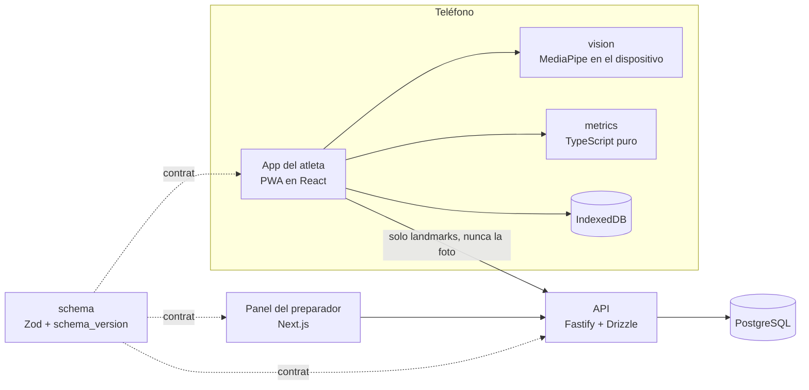

# Golden Classic

Plataforma de progreso físico y posing para culturismo clásico: del atleta que compite al
que solo entrena. Mide el cuerpo y la pose con la cámara del teléfono y le muestra a cada
persona cómo evoluciona.

**Estado:** en fase de pruebas, con entorno de pruebas desplegado. Probada en teléfonos y en escritorio.

> Este repositorio es la presentación del proyecto. El código fuente es privado y propietario;
> lo muestro a pedido en procesos de selección. Contacto: [portfolio](https://dilaciolautaro.github.io/portfolio/) ·
> [LinkedIn](https://www.linkedin.com/in/lautaro-di-lacio)

## Qué hace

- **Para el atleta:** mediciones en vivo de V-Taper, ángulos, simetría y Canon Griego sobre
  las 8 poses clásicas y un catálogo de 23; sala de práctica con esqueleto de referencia;
  comparación con capturas de meses anteriores.
- **Para quien no posa:** analiza fotos de frente, perfil o espalda desde su galería y sigue
  su progreso con medidas de cinta, cada diferencia con su margen de error.
- **Para el preparador:** panel web con una bandeja de check-ins ordenada por quién necesita
  atención, anotaciones de voz sobre el esqueleto del alumno, rutinas y plantillas.

## Arquitectura

Monorepo TypeScript (pnpm + Turborepo) con tres aplicaciones y cuatro paquetes compartidos.

| Pieza | Qué es |
| --- | --- |
| App del atleta | PWA: mediciones, sala de práctica y ajustes (respaldo, bloqueo, preparador, comunidad). Funciona offline. |
| Panel del preparador | Next.js. Se entra con un enlace de acceso, sin contraseña. |
| API | Fastify + Drizzle sobre PostgreSQL: vínculo atleta-preparador y comunidad. |
| `schema` | El contrato de datos: Zod, con `schema_version` en cada registro. |
| `metrics` | El motor de medición: V-Taper, simetría, ángulos, antropometría. TypeScript puro, sin dependencias. |
| `vision` | Wrapper de MediaPipe con carga diferida; si falla, la app degrada y avisa. |
| `ui` | Componentes y tokens de marca. |

## Decisiones de diseño

- **La visión corre entera en el dispositivo.** Al servidor solo viaja el vector de landmarks,
  nunca la imagen.
- **Todo dato nuevo pasa por el contrato versionado.** `schema_version` viaja dentro de cada
  registro y sobrevive al export/import; la app rechaza un registro de una versión más nueva en
  vez de leerlo a medias.
- **Toda métrica entra con su fixture de referencia:** landmarks de entrada y salida esperada.
  Sin test, la métrica no existe.
- **El tier gratuito no hace llamadas de red en su ruta de uso:** fuentes empaquetadas, MediaPipe
  como dependencia y modelos cacheados por el service worker.

## Calidad

- Tests con Vitest, verificación de tipos y lint por paquete.
- CI en GitHub Actions sobre Linux y Windows, más una pasada contra PostgreSQL y el build de la
  imagen de la API.
- Despliegue automático al entorno de pruebas, condicionado a que el CI pase.

## Stack

TypeScript · React · Next.js · Fastify · Drizzle · PostgreSQL · Zod · MediaPipe · Vitest ·
pnpm · Turborepo · GitHub Actions · Docker

---

© 2026 Lautaro Di Lacio. Todos los derechos reservados.
